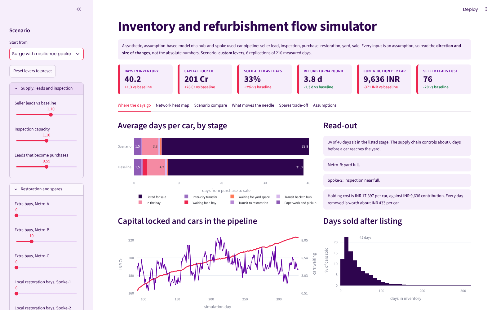

# Used-car inventory and refurbishment flow simulator

A working simulator and dashboard for a hub-and-spoke used-car supply chain. It answers one question: **where do days and capital get stuck between buying a car and selling it, and which fixes are worth their cost?**

It was built as an additional project for a supply chain application at Spinny. The network, volumes and costs are **synthetic and assumption-based**. Public FY25 figures are used only to keep the unit economics in a believable range, and every input carries a tag: Sourced, Derived or Assumption.

| | |
|---|---|
| Deck (problem, solution, implementation) | `deck/Spinny_Inventory_Flow_Deck.pptx`, PDF copy in `deck/` |
| Written strategy and findings | `STRATEGY.md` |
| Interactive app | `app.py` (Streamlit) |
| Simulation engine | `flowsim/` |
| Network you can edit | `data/network.csv` |
| Assumption register | `data/assumptions.csv` |
| Regenerate every number in the deck | `python scripts/make_results.py` |

## What it shows

Baseline network: 3 metro hubs with 349 restoration bays and 3 spokes that haul cars to a hub and back, about 2,150 cars sold a month.

- A car spends **39.0 days** from purchase to sale. **31 of those are listed-for-sale time**, which is sales-side. The supply chain owns about 8 days.
- The network is fine on average and fragile at the edges. Metro-B runs bays at 99% and carries two spokes.
- A **+10% lead surge** takes refurbishment turnaround from 5.3 to 8.4 days, quadruples lost seller leads (97 to 387) and cuts contribution per car by 25%.
- A **parts fill-rate drop from 95% to 90%** takes turnaround to 13.3 days and cuts contribution per car by 28%.
- A sequenced package (parts fill 98%, stock rebalancing, local restoration at Spoke-3, +10 bays at Metro-B, then inspection and yard) brings the surge back to 3.8 days, 77 lost leads and Rs 9,563 per car.
- Levers pulled alone often fail. Extra inspection capacity on its own **lowers** contribution because it feeds full bays. A 3% markdown at 45 days costs Rs 1,853 a car.

Full tables and method are in `STRATEGY.md`.

## Run it

```bash
python -m venv .venv && source .venv/bin/activate     # optional
pip install -r requirements.txt
streamlit run app.py
```

Then open the address Streamlit prints (usually http://localhost:8501).

```bash
pytest tests                    # 10 tests, about 30 seconds
python scripts/make_results.py  # rewrites results/*.csv and summary.json, about 3 minutes
cd deck && node build_deck.js   # rebuilds the deck from results/ (needs pptxgenjs)
```

Python 3.10 or newer. Runs are seeded, so results repeat exactly.

## The app

Six tabs: where the days go (stage bars, capital and queue series, read-out), a city heat map of bay, inspection and yard pressure, baseline-versus-scenario compare, one-lever sensitivity, the parts fill-rate trade-off, and the assumption register. The sidebar has presets (festive surge, surge with package, parts shock, demand dip) and more than 20 levers.



## How the model works

Daily steps, 330 simulated days per replication (120 warm-up, 210 measured), 8 replications with fixed seeds for the headline numbers.

1. **Leads and inspection.** Seller leads arrive per city, capped by inspection capacity. Excess leads are abandoned with a probability.
2. **Purchase and paperwork.** Capital is locked at purchase. A paperwork lag follows.
3. **Haul.** Spoke cars travel to the parent hub and back. A spoke can be switched to local restoration.
4. **Refurbishment.** A bay queue per hub. Each job needs several part lines. If any line is out of stock the car stays on the lift for the emergency lead time. A share of cars fail QC and repeat.
5. **Yard and sale.** Yard capacity limits listings. Sales per day are Poisson with a rate that rises with the number of cars on offer. Aged cars can be marked down.
6. **Rebalancing (optional).** Aged cars move from cities with high days of supply to cities with low days of supply.
7. **Costs.** Holding cost is capital cost plus yard cost plus market price erosion, plus transfer costs. Contribution per car is margin minus all of that.

Spares working capital uses cycle stock plus safety stock, with the z-score from the target fill rate.

## Limits you should know

- Every volume, price, cost and capacity is an assumption. Read the size and direction of changes, not absolute levels.
- Sales-side behaviour (pricing, demand, listing quality) is simple on purpose. The model is for supply chain levers.
- No real company data is used. `data/network.csv` is a scaled replica and editable.
- Bay fit-out and staffing costs used in the deck economics are placeholders (Rs 4 lakh and Rs 6 lakh a year per bay).

## Public context behind the sourced inputs

FY25 revenue, procurement and direct-cost figures come from press coverage of Spinny's FY25 financials (Inventiva, Inc42, Capital Insider). The hub, Park and restoration-centre footprint comes from Inventiva and company press releases. The duties modelled (spares, inventory, turnaround) follow a public Program Manager, Spares and Inventory job description. See `data/assumptions.csv` for each figure and its basis.

## Layout

```
app.py                  Streamlit app
flowsim/                engine, config, spares, presets, insights
data/                   network.csv, assumptions.csv
tests/                  pytest suite
scripts/make_results.py regenerates results
results/                scenario, sensitivity and fill-rate tables
deck/                   pptx, pdf, preview images, deck builder
assets/                 app screenshots
.streamlit/config.toml  theme
```
